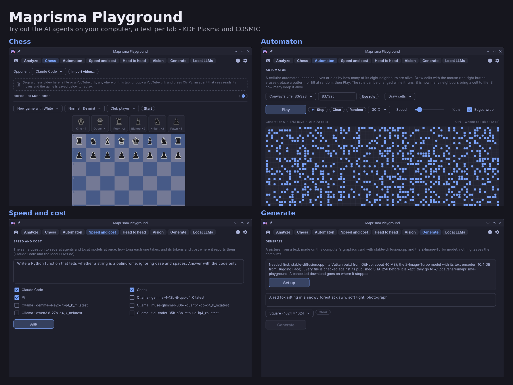

# Maprisma Playground

Try out the AI agents on your computer, one test per tab:
- **Analyze** (the test-tube symbol in the header): see at a glance what an agent and its model can
  do.
- **Chess:** play against Claude Code, Codex, Hermes or Pi, or let two of them play each other.
  An agent that runs on a local LLM plays with that model.
- **Automaton:** watch a cellular automaton.
- **Speed and cost:** compare how fast the agents answer and what it costs.
- **Head to head:** judge two answers blind.
- **Vision:** test what they see in a picture.
- **Generate:** make pictures from a text on your own graphics card.
- **Local LLMs:** ask your local models and see their tokens per second.

It is the Flutter port of [AI Playground](https://github.com/uBruckhaus/omarchy-ai-playground), the
Omarchy plugin, for **KDE Plasma** and **COSMIC**. It goes with
[Maprisma](https://github.com/maprisma/maprisma), which shows and changes how the agents are set up;
Maprisma Playground asks them. The one exception is Analyze, which may set up a local model for
pictures (see "Shared settings Analyze may change" below).

**It works with every installed coding agent Maprisma knows:** Claude Code, Codex, Hermes and Pi with
their own settings (pictures, thinking time, chess), the others of Maprisma's helpers list (Gemini CLI,
Antigravity, Cursor, Copilot, Grok, Oh My Pi, OpenClaw …) for questions, as that list runs them; one
nobody has tried yet is marked "(untested)". After a newer Maprisma list: copy its
`data/helpers.json` to `packages/maprisma_playground_core/data/` and run `tools/gen-helpers.py`.



## Install

With [Maprisma Manager](https://github.com/maprisma/manager): **Install** on Maprisma Playground.

From the source (Flutter, Dart, cargo; no root needed):

```sh
git clone https://github.com/maprisma/playground.git maprisma-playground
cd maprisma-playground
FLUTTER=/path/to/flutter/bin tools/install-local
```

This installs into `~/.local/lib/maprisma-playground`, with links in `~/.local/bin`, a desktop
entry and icons.
- **KDE Plasma:** a tray icon (a gamepad) is started and starts again at login. The Maprisma Icons
  panel widget shows it with the other Maprisma apps.
- **COSMIC:** add "Maprisma Playground" in Settings › Desktop › Panel › Applets.

A click on the icon opens Maprisma Playground; when the window is shown (focused or not) it hides
it while something runs (a game, a generation, an agent, a download) and closes it otherwise
(`maprisma-playground --toggle`). Esc on a tab does the same. `maprisma-playground --test chess`
opens a tab (or `--test analyze` the Analyze page), including in a window that is already open.

Optional tools, each only for the feature named:
- `yt-dlp`, `ffmpeg` and `ffprobe`: reading a chess game from a video, and video frames on Vision.
- `spectacle` (KDE), `cosmic-screenshot` (COSMIC) or `grim`: Screenshot on Vision.

## The tabs

The tabs fill the header's width and wrap onto more lines in a narrow window; the symbols at the
right stay in view: the test tube (Analyze), ⓘ (Information) and the gear (Settings). Each opens a
page with a Back button, lit while it is open.

- **Analyze** (the test-tube symbol in the header, beside ⓘ and the gear): pick an agent and one of
  its models. There is one card per capability (text,
  pictures, chess videos, thinking time, chess, context, making pictures), with a mark: green ✓
  can, red ✗ cannot, yellow ! only slowly, ? not stated. A few short test questions are asked; the
  rest is read from the agent's own settings and model lists.
- **Chess:** play against an agent, or let two agents play each other (also agents that run on local
  models), each with its own strength.
  - The board checks every move. An agent that answers with an illegal move is asked again.
  - You can set up a position by hand.
  - Games are saved, replayed move by move, renamed and saved as PGN.
  - A game can be read from a chess video (a file or a YouTube link).
- **Automaton:** a cellular automaton you draw on. It has Life-like rules in B/S notation (Conway's
  Life, HighLife, Seeds, Day & Night, Brian's Brain …, or your own), patterns such as the glider
  and the Gosper glider gun, random fill, step, speed, and wrapping edges. Nothing is asked of any
  agent.
  - The text under the heading tells what the chosen scenario does.
  - The ⓘ beside the rule explains the scenario; the ⓘ beside Draw cells explains drawing in it
    (or the pattern, with a note when it is made for Conway's Life but another rule is chosen).
    Read more is one drop-down with all their links, opened in the browser.
- **Speed and cost:** one question to several agents and local models; their answers side by side,
  with time, tokens and cost where the agent reports them.
- **Head to head:** one question to two agents or local models. You pick the better answer. In
  **Blind** mode you see who wrote which only afterwards. The score is kept.
- **Vision:** a picture, a screenshot or four frames of a video, for the agents that can see and
  run without tools (Claude Code, Pi). Pictures are scaled down and saved again first, so no photo
  metadata goes out.
- **Generate:** a picture from a text, made on this computer's graphics card with
  [stable-diffusion.cpp](https://github.com/leejet/stable-diffusion.cpp) and the
  [Z-Image-Turbo](https://huggingface.co/leejet/Z-Image-Turbo-GGUF) model. The first time, **Set
  up** downloads the program (about 40 MB) and the model with its text encoder (about 11 GB), each
  file checked against its SHA-256.
- **Local LLMs:** one question to a model of a local LLM server running on this computer
  (llama.cpp, Ollama, LM Studio, vLLM, Jan, KoboldCpp), with its time and tokens per second,
  optionally compared with a second model. When two local models might not fit in the graphics
  card's memory together, you are asked first.

Keys:
- Ctrl+1 … Ctrl+7 switch tabs.
- Ctrl+, opens the settings.
- Esc or Backspace goes back from Analyze, Information, Settings and the saved games.
- F12 saves a picture of the window to `~/Pictures/Maprisma Playground/` and asks for an optional
  note about what is wrong (a `.txt` next to it). Settings › F12 saves a screenshot turns it off.

**Dictation** (Omarchy): the microphone in the lower right corner of a question field (Speed and
cost, Head to head, Vision, Generate, Local LLMs) works like Omarchy's dictation key: it starts
dictation with the cursor at the end of the field, or stops it when it runs.

**Corners** (Settings): like the desktop's windows, slightly rounded (6 px), rounded (12 px) or
square. Every control follows it in three sizes: cards, dialogs, pop-ups, the chess board and the
automaton grid take the full radius; buttons, choice boxes and fields at most 8 px; check boxes,
slider tracks, progress bars and colour swatches at most 4 px. Square squares all of them.

**Languages:** English, Deutsch, Français, Español, Italiano, Português, Nederlands and Polski, as
AI Playground has them. The language follows the system unless Settings › Language picks one.

## How the agents are asked

Each agent is started once per question, the way its own command line offers for one prompt and one
answer:
- `claude -p --tools ""`: no tools.
- `hermes -z`: only its in-memory task list.
- `pi -p --no-tools --no-mcp --no-skills --no-context-files`: no tools.
- `codex exec --sandbox read-only`: Codex keeps its tools, inside its read-only sandbox. That is why
  it is never given anything from outside (see below).

The rules for each run:
- It runs in an empty private folder (created 0700, deleted afterwards).
- It has a time limit, and its answer is read with a size limit.
- Its whole process group is stopped when the time is up, when you cancel, or when the app closes.
- Claude Code, Codex and Pi get the question on stdin. Hermes takes it only as an argument.
- Every program is started as an argument list, never through a shell.
- Nothing an agent answers is run.
- What comes from the web (a video's captions, pictures) goes only to agents without any tools.
  Codex's read-only sandbox can still read files, so it never gets it.

## Shared settings Analyze may change

When a local model could see pictures but lacks its vision file (a projector), the Pictures card
offers **Download the vision file**. After you click it, Analyze does the following:
- It puts the file next to the model.
- It adds the file to `~/.config/llama.cpp/models.ini`, or to Pi's model entry. The old file is
  backed up first and the new one is written in one step.
- It may restart the local LLM server it started for the test.

These settings belong to the local LLM and Pi, so removing Maprisma Playground leaves them in place.
Nothing else outside `~/.config/maprisma-playground` and `~/.local/share/maprisma-playground` is
changed.

## Privacy

The agents send the question to their own providers, as they always do; Maprisma Playground adds
nothing. Local LLM servers are asked only when they run under your own account, at 127.0.0.1,
without a proxy. Generate downloads only from GitHub (stable-diffusion.cpp's release, checked by its
published digest) and Hugging Face (files pinned by size and SHA-256). Settings and saved games stay
in `~/.config/maprisma-playground`.

**Screenshots** (F12) are saved only when you press it, in `~/Pictures/Maprisma Playground/` (the
pictures folder of `user-dirs.dirs`), as new files readable only by you (folder 0700, files 0600,
never over an existing file or through a link), and only into a real folder of yours that others
cannot write to; a file is written completely or not at all. A note you type goes next to it as a
`.txt`. The
window draws itself into the picture: no screenshot program is started and nothing is sent
anywhere.

**Dictation**: the microphone beside a question field works like Omarchy's dictation key: it puts
the cursor at the end of the field and runs `omarchy-dictation toggle` (the backend set in Setup ›
Defaults › Dictation, e.g. Superwhisper), which starts dictation or stops it when it runs; that
program writes what you say at the cursor and shows its own recording indicator. Maprisma
Playground keeps no recording state and records nothing itself; whether the words are recognised on
this PC or by a cloud service is the backend's setting. No backend set up yet: a click on the
microphone explains how (Setup › Defaults › Dictation) and can open that menu; away from Omarchy
there is no microphone. The programs are started as argument lists, never through a shell, and the
backend's name is read bounded (64 KiB, 3 s).

**Automaton**: the ⓘ windows' "All links" list opens fixed `https://en.wikipedia.org/wiki/…` addresses
(listed in `automaton_info.dart`) in your browser, only when you choose one.

## Building and testing

```sh
cd packages/maprisma_playground_core && dart test     # the core: rules, runner, agents, chess, automaton
cd flutter_app && flutter test                        # the window
cd bar && cargo test                                  # the tray's menu
```

Live checks of the real app with your agents and local LLMs (they ask Claude Code a few short
questions, which costs a little of its plan, and the small Gemma model on Ollama when it is there):

```sh
cd flutter_app
MAPRISMA_PLAYGROUND_NON_UNIQUE=1 XDG_CONFIG_HOME=$(mktemp -d) flutter test integration_test/live_test.dart -d linux
```

The plan and the reviews are in `docs/`. The core speaks the protocol in `docs/protocol.md`.

## License

MIT, like AI Playground.
